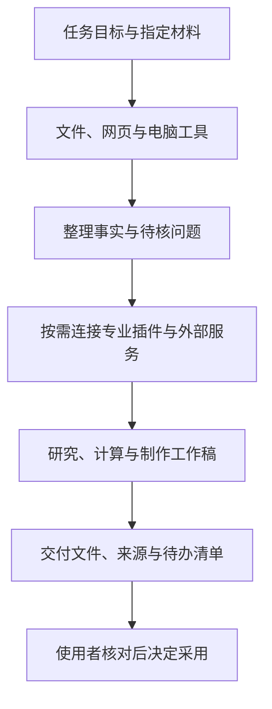

# 认识 Kayak：桌面任务与法律工作

Kayak 是桌面 AI 助手。你可以用日常语言交代目标，让助手读取指定材料、查阅网页、核对数据，再生成 Word、Excel、PDF 或演示材料；需要操作软件界面时，还可以使用已启用的电脑操控与浏览器功能。

法律工作是这些能力的一种用途。客户端没有需要单独切换的“法律工作区”模式；律师、法务人员和法院承办人员使用同一套任务入口，再说明各自的角色、材料范围和成果要求。

## 可以从哪些工作开始

| 工作      | 可以提出的目标               | 需要核对的内容            |
| :------ | :-------------------- | :----------------- |
| 材料整理    | 在指定目录建立文件索引、时间线和证据对照表 | 原件位置、检索范围、遗漏及重复材料  |
| 法律研究    | 查阅公开规范和相关案例，比较适用条件    | 原文、效力时间、案件事实与程序差异  |
| 计算与对账   | 汇总付款、识别疑似重复凭证、按给定口径计算 | 实际交易、起止日期、抵扣顺序和公式  |
| 文书与报告   | 起草申请书、研究说明、表格或培训材料    | 主体、案号、金额、落款、附件和格式  |
| 软件与网页操作 | 阅读获准窗口、填写已确认信息、另存副本   | 操作对象、上传范围和提交前的人工检查 |

这些任务不一定要组合成完整报告。只检查一处引文、只改一段申请事项，或只整理一张付款表，都可以直接提出。

## 桌面能力怎样配合专业功能

本地文件工具负责读写材料，浏览器负责查阅网页，文档工具负责制作成品；插件可以为助手补充特定工作方法或外部服务连接。已开通的执行事务与企查查功能，可以进一步用于执行研究、文书起草和企业信息核对。

下面是能力之间的关系。它表示可以怎样组合任务，不代表每个账号都已开通全部外部服务，也不要求每次任务都经过所有环节。

使用前先在“扩展”中查看可用插件和连接器。能否使用某项外部查询，取决于当前账号、安装状态、服务授权和网络；查询不到不等于没有相应记录。具体方法见[插件与连接器](/start/04-plugin-activation)。

## 任务、项目与案件目录怎样分工

**任务**保存围绕一个目标展开的对话。比如先核对付款，再补一份协议、修改同一张表，可以继续在原任务中完成。需要明确告诉助手新材料替代还是补充了哪项旧信息；原先已经确认的结果也可能因此需要修订。

**项目**帮助组织相关任务，并关联本地工作目录。同一案件可以分别建立“材料索引”“法律研究”“文书起草”等任务，但它们若都改同一份文件，仍可能相互覆盖。安排不同输出文件名，最后再统一核对，而不是认为分成几个任务后内容会自动合并正确。

**案件目录**是电脑上的实际文件位置。侧栏归档任务不会自动删除原件；聊天里看到一张表，也不等于目录中已经保存 Excel。可以要求助手明确列出读取范围和保存位置，再在文件管理器中打开核对。具体入口见[桌面操作入门](/start/basics/00-desktop-quickstart)。

例如，“甲乙合同案”项目里可以用一个任务整理合同、回单和时间线，再用另一个任务研究争议。研究时引用前一轮已核对的索引，并注明资料版本；后续收到补充协议时，先修订索引，再检查计算表和文书是否需要一起更新。项目用于减少工作散落，不能替代材料权限和版本管理。

## 开始前要明确的边界

安装在电脑上不等于所有处理都在本地完成。模型回答、联网检索、外部连接器和远程文字识别可能涉及网络传输；读取扫描 PDF 或 Office 内嵌图片时，文档工具可能自动使用远程 OCR，且不逐次询问。材料不允许外传时，应在开始前明确禁止远程 OCR 和其他外部上传，并使用本单位批准的环境。

案件目录和项目帮助组织工作，不构成独立的保密隔离。当前任务若使用“完全访问”，可访问范围可能超过你指定的案件目录。先阅读[数据与操作权限](/start/basics/07-security-boundary)，再从[桌面操作入门](/start/basics/00-desktop-quickstart)完成第一个任务。
