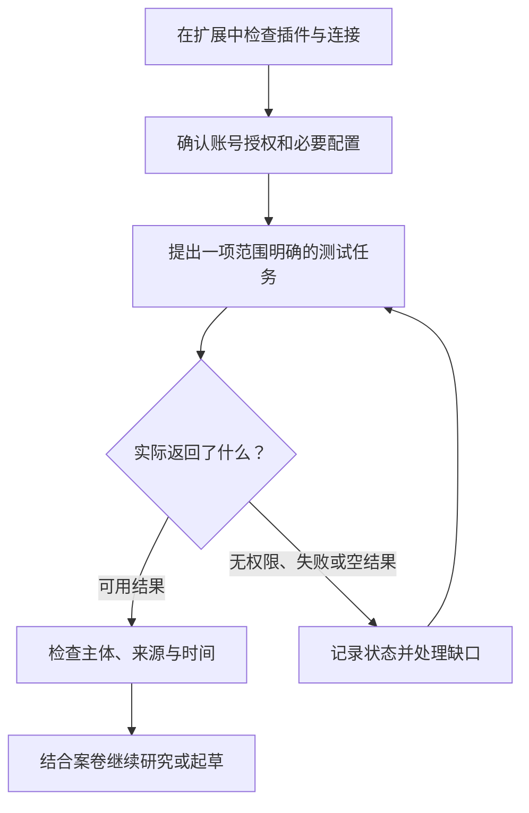

# 执行事务与企查查插件

Kayak 可以整理文件、查阅网页和制作办公成果。执行事务与企查查插件在这些通用能力上，补充法律工作流程和企业资料查询。先确认插件可用并已连接，再用自然语言提出任务。

## 执行事务怎样安装和启用

管理员为所属企业开通法律工作模式后，成员登录客户端时会按账号策略自动安装并启用“**执行事务**”插件，无需逐个手动安装。该企业策略生效时，插件也可能显示为不可停用或卸载。

普通账号是否提供该插件，应看“扩展”中的实际可用项目和服务授权。安装或启用成功不代表全部法律服务都已开通；企业法律模式本身也不授予企查查等第三方服务的权限。

在侧栏“扩展”中，可以直观查看“执行事务”的运行与连接状态。如果客户端提示连接失败或无权限，请先检查本地网络连接，或向管理员确认当前账号的法律服务授权是否正常生效。

## 执行事务可以协助什么

| 工作         | 可以直接提出的要求                            |
| ---------- | ------------------------------------ |
| 法律检索与研究    | 查找法规、司法解释和相关案例，保留出处，比较与本案事实的异同       |
| 案件材料分析     | 整理时间线、主体关系及主张与证据的对应关系，区分陈述与已确认事实     |
| 金额计算与核对    | 说明执行依据、利率、期间、还款和费用口径，再计算并提供可复核明细     |
| 普通文书与调查令材料 | 说明文书名称、使用角色和调查范围，起草所需 Word 文件        |
| 法律意见书      | 根据同一案情制作咨询版与专业版，并按需要提供 Word、PDF及机构样式 |

执行事务的部分检索、分析与文档工具需要连接云端法律服务；本地文件整理、插件内排版与云端处理各有用途。使用前按单位要求确认材料允许进入相应处理环境。

检索结果仍需打开原文核对版本、条文及适用条件；未检索到不等于不存在。需要公开网页补充时，可以明确要求搜索并阅读原文，不必把所有法律研究都当作同一数据库查询。

法院人员应说明自己的工作角色、已经核对的事实及拟起草的文书。自然语言说明角色不会改变服务授权，生成工作稿也不等于已经获得法院签发、签章或系统办理权限。调查令的具体模板和使用条件见[调查令申请与材料准备](/workflows/execution-audit/10-investigation-order)。

## 企查查需要用户自己的 API Key

企查查使用独立的账号权益，与 Kayak 登录和余额分开。企业身份、股权关联、公开风险、资质及知识产权等查询，均以已连接服务和企查查账号权益为准。

1. 在当前可获得的企查查插件安装或待配置流程中，打开 API Key 配置表单。
2. 前往[企查查 API Key 页面](https://agent.qcc.com/profile/api-key)，使用自己的企查查账号取得 Key。
3. 将 Key 填入插件的密码配置框，点击确认，完成连接验证。
4. 再提出一项范围明确的查询，例如核对一家公司的登记信息，并查看实际返回结果。

Key 不发到聊天中，也不写入案卷或共享文件。插件通过操作系统的安全凭据存储保存配置；同一操作系统登录下切换 Kayak 账号，不会自动切换企查查 Key。共用电脑时应确认当前使用的是谁的企查查权益。

如果插件列表没有企查查，或没有相应配置入口，请先向管理员确认提供方式和版本。不要把源码目录存在、插件已安装或连接验证通过，当成已经完成企业数据查询。

默认连接覆盖企业信息、风险、人员、经营和知识产权相关服务。历史档案、法规、案例、标讯及文档解析属于可选服务，并非安装后全部开启；部分内容还受企业认证或其他账号权益限制。具体任务见[企查查的九类工作](/workflows/execution-audit/13-qcc-enterprise-data)。

企查查不提供银行账户余额或交易流水查询。只根据你提供的合同、流水和回单对账，无需先做企业查询，也不需要为此配置企查查 Key。

## 组合使用时把最终目标说清楚

> 请先核对乙公司的登记身份，围绕本次货款纠纷整理相关股权变更和公开涉诉记录，保留来源与查询时间。再结合我提供的合同和回单分析需核实的问题，起草一份情况说明 Word。不要把关联企业财产写成乙公司的财产，未知信息不补造。

助手可以在同一任务中复用已查结果，继续研究、计算或制作文件。遇到权限不足、查询为空或服务失败时，应说明状态和影响；你可以先让助手完成现有材料支持的部分，再补充新资料。

## 先验证连接，再做组合任务

不要用一大包正式案卷测试插件是否能用。先选一项范围小、允许处理的任务，分别确认连接和结果，再加入需要研究、计算或起草的材料。

以下是验证时应观察的区别，示例不表示已经发生过查询：

| 看到的状态 | 能确认什么 | 接下来做什么 |
| --- | --- | --- |
| 扩展页显示已启用 | 插件在客户端处于可用配置 | 再检查需要的服务是否连接、账号是否有权使用 |
| 配置验证成功 | 本次凭据或连接测试通过 | 发起一项具体查询，不能把连通测试当成正式结果 |
| 返回一家企业的登记资料 | 本次请求取得了对应资料 | 核对企业全称、统一社会信用代码、来源和查询时间 |
| 返回为空或提示权益不足 | 当前请求没有取得可用资料 | 保留原提示，检查查询范围、账号权益和配置，不写成该企业没有相关记录 |

例如，先要求“只核对我指定公司的登记身份，列出企业全称、统一社会信用代码、资料来源及查询时间”。发现与合同抬头不一致时，先把两种名称并列，请承办人员确认交易对象；不要自动换一家相似名称公司继续查询，再把结果接到本案。

连接确认后，再补充合同、回单和具体交付目标。若外部查询失败，仍可以先整理你提供的本地材料，但应在研究说明中写清尚未完成哪项查询。排查方法见[常见问题](/manual/04-troubleshooting-faq)。
