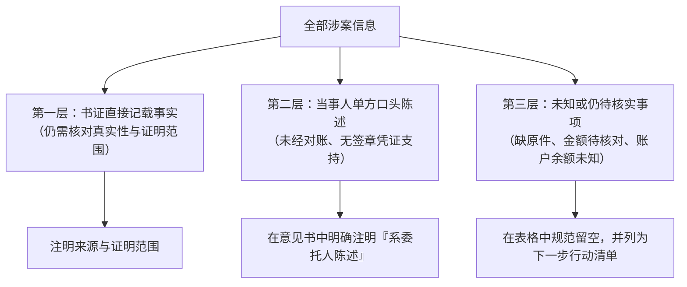

# 案件事实输入规范：事实三层表达法

材料与陈述混在一起时，助手可能沿用提示词中的未经核实判断。例如“对方隐匿了收入”是需要证据支持的主张，不能因为写进要求就成为已查明事实。

整理时可用下面三层区分信息来源。它帮助发现事实跳跃，不代替证据审查，也不表示材料直接记载的内容已经由法院认定。

***

## 一、法律事实的三层结构

在向 Kayak 提交案情背景或上传材料时，指导助手按照以下三个层次进行归类与表述：



### 1. 第一层：材料直接记载的事实

* **定义**：有合同签署文本、银行转账凭证原件、法院生效裁判文书明确载明的内容。
* **表述原则**：先写“合同载明”“回单显示”等来源限定。材料真实性、完整性、用途和相反证据仍需核对，不直接改写为法院已查明事实。
* **示例**：“*买卖合同第三条载明单价为 1200 元/吨；银行回单显示 2026 年 8 月 1 日甲向乙转账 20 万元整。*”

### 2. 第二层：当事人单方陈述事实

* **定义**：客户或委托人口头陈述、微信单方留言，但尚未见到对方确认函或收条原件。
* **表述原则**：在生成的文书中必须使用严谨的法律限定词，如“*据委托人陈述*”、“*申请人主张*”，绝不能写成“*已经证实*”。
* **示例**：“*申请人称对方尚有仓储收益 50 万元，但目前无对账单原件。*”

### 3. 第三层：未提供或仍不明确的事项

* **定义**：案件中缺失的关键链条，如银行具体支行、账户即时余额、对方是否收到解除函等。
* **表述原则**：**不提供 ≠ 不存在**。明确要求助手将其标注为“*待进一步向当事人或法院核实的事项*”，不能编造，不能直接假定。

***

## 二、对比示例：普通提问 vs 结构化专业提示词

### ❌ 错误提问（容易诱发模型幻觉）：

> “这是我们收集到的 8 张转账回单，一共 12 万元。对方公司欠我们园区租金，帮我写一份情况说明，证明对方隐匿了 12 万元园区收入。”

*问题诊断*：这种提问容易诱使助手把 12 万元写成“已查明的园区收入”，但实际上其中 3 张回单付款人与合同相对方不一致，且 12 万元只是提交材料的账面数字，并未核实银行原件，一旦提交法庭将极为被动。

### ✅ 正确提问（严格运用事实三层法）：

```markdown
请帮我把这组仓储园区收益材料整理为一份叙述式情况说明：

1. 事实限定：
   - 目前整理出转账回单 8 份，账面累计金额 120,000.00 元；
   - 经初步梳理，其中 5 份回单能够与主合同相对应，另外 3 份付款人与相对方不一致（保留关联疑问，不自行推定法律性质）；
   - 园区完整月收入和相关银行账户当前余额未知。
2. 表达规范：
   - 严格区分在案材料客观记载与我方陈述；
   - 将 12 万元清晰表述为『我方提交材料的账面合计』，严禁写成『经查实已证明的园区收入』；
   - 列明我方后续拟对账核实的计划，生成 Word 文档。
```

生成后检查每项主张能否回到材料位置，尤其核对金额、主体和限定词。收到更正材料时，在原任务指出采用哪一份，并要求同步检查相关文书和计算表。
