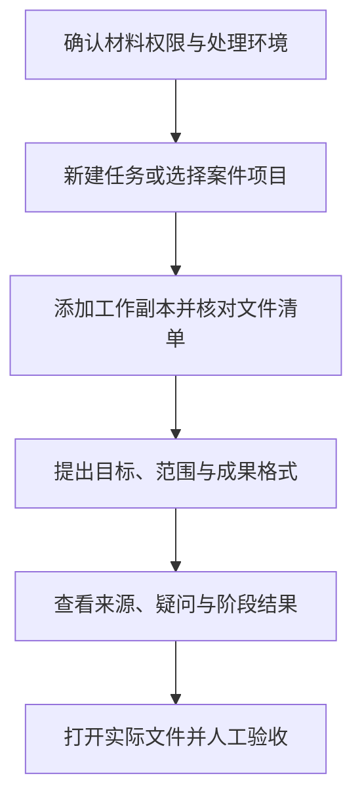

# 快速上手概览

先学会建立任务、选择材料和打开成果，再逐步加入法律研究、企业查询与浏览器操作。法院承办人员还应先确认院内允许的使用环境、材料范围与审批要求；本指南不代表 Kayak 已接入法院业务系统。

## 推荐阅读顺序

1. [认识 Kayak：桌面任务与法律工作](/start/01-what-is-kayak)：了解文件处理、网页查阅与文档制作怎样配合。
2. [客户端安装与案件目录](/start/02-installation-setup)：安装、浏览器登录授权，以及原件与工作副本的目录安排。
3. [桌面操作入门](/start/basics/00-desktop-quickstart)：从“新任务”开始，添加附件、使用项目、打开成品和停止任务。
4. [登录、思考强度与账户额度](/start/03-model-account)：设备授权登录、任务思考强度调节与账户额度管理。
5. [执行事务与企查查插件](/start/04-plugin-activation)：了解企业法律账号的插件自动安装策略，以及企查查的独立凭据与连接验证。
6. [第一个法律任务](/start/basics/05-first-legal-task)：用角色、阶段、事实与结果说明任务。
7. [事实三层表达法](/start/basics/06-prompt-formula)：区分材料记载、当事人陈述和未知事项。
8. [数据与操作权限](/start/basics/07-security-boundary)：了解完全访问、远程 OCR、文件改写与停止后的核对。

## 一个可直接开始的小任务

> 请只处理我添加的合同和两张回单，整理一张付款核对表，列明来源、金额和对应关系。保留原件，输出可编辑 Excel；不确定的内容标注待核对。开始前先说明将处理哪些文件。

需要多个成果时，可以继续在同一任务中提出；需要定时跟进时，再阅读[定时任务与案件动态跟进](/workflows/interactive-agents/05-scheduled-monitoring)。

## 从材料到成果，完整走一遍

初次使用可以先做一个范围小、容易人工验收的任务。以下是学习顺序，实际工作可以停在其中任一步，不必每次都生成整套报告。

例如，练习材料可以是《合同工作副本.pdf》《回单-01.png》《回单-02.png》。先让助手列出这三份文件，确认它没有把其他案件材料加入处理范围；再提取合同总价与回单金额，保留每笔金额的来源。两张图片是否属于同一交易尚不清楚时，先输出疑似重复清单，不急着汇总成已经付款的事实。

第一轮只验收付款核对表。第二轮补上你已确认的交易关系，再要求另存 Excel。打开文件后检查账号是否保留前导零、汇总是否引用正确行、尚未确认的款项有没有混入已付款合计。按“明确范围—查看依据—修正疑问—验收文件”的顺序推进，能够清楚看到每轮工作处理了什么、还缺什么。

## 按自己的角色安排阅读

### 律师与诉讼、执行团队

先掌握[案卷整理](/workflows/case-prep/01-case-file-organization)和[主张与证据对应](/workflows/case-prep/07-claim-evidence-mapping)，把材料位置、委托人陈述及缺口分开；再进入[法规与类案检索](/workflows/case-prep/02-browser-law-search)。需要提交文书时，按照具体用途阅读[普通文书](/workflows/document-delivery/09-legal-documents)、[调查令材料](/workflows/execution-audit/10-investigation-order)或[双版法律意见书](/workflows/document-delivery/11-legal-opinion-dual)。

第一次完整练习可选[终本后的账户线索](/recipes/enforcement/02-enforcement-recovery-after-three-years)：先把已有记录和新线索分开，再起草供人工核对的材料。不要一开始就要求助手给出“必定恢复执行、必定查到财产”的结论。

### 企业法务与合同、风控人员

以合同、履行记录和实际交易为起点。先看[合同修改对照](/recipes/casework/01-contract-review)和[付款去重](/recipes/finance/01-goods-payment-dispute)，把修改依据与对账口径说清楚。确需核对交易对象时，再按[企查查企业查询](/workflows/execution-audit/13-qcc-enterprise-data)连接自己的账号权益，并查看[企业调查边界](/workflows/execution-audit/14-enterprise-investigation-boundaries)。

一轮任务可以交付“合同问题表、付款核对表、待补材料清单”。需要形成完整意见时，再合并这些已经核对的结果；股权关系图、公开涉诉记录和客户陈述各有用途，不能直接合成已经成立的责任结论。

### 法院承办人员与办案辅助人员

先读[人工智能使用规范](/manual/03-supreme-court-ai-compliance)，确认本院允许使用的环境和材料范围，再用脱敏副本练习[法院材料审查](/recipes/enforcement/11-court-material-check)。需要计算时单独核对[金额、利息与案款口径](/workflows/execution-audit/08-interest-calculation)，起草时明确要求[法院角色的工作稿](/workflows/document-delivery/13-court-drafting)。

这条路线的阶段成果是材料索引、争议对照、待审查事项和文书草稿。生成文件不能替代审批、签章、入卷或司法决定，也不能证明软件已经接入具体法院系统。

### 当事人与准备向专业人员交材料的人

从[第一个法律任务](/start/basics/05-first-legal-task)开始，把自己的身份、材料范围和希望解决的问题说明白；用[事实三层表达法](/start/basics/06-prompt-formula)区分“材料写了什么、我方认为发生了什么、还有什么不知道”。先交付清楚的时间线、材料目录和问题清单，再交给承办律师或其他专业人员判断。

不清楚文书名称时，可以先描述用途，例如“整理给律师看的付款经过”，不要为了套用模板而补造案号、法院、账户余额或已经发生的程序结果。遇到文件打不开、查询失败或材料识别不全，按[排错指南](/manual/04-troubleshooting-faq)逐项检查。
