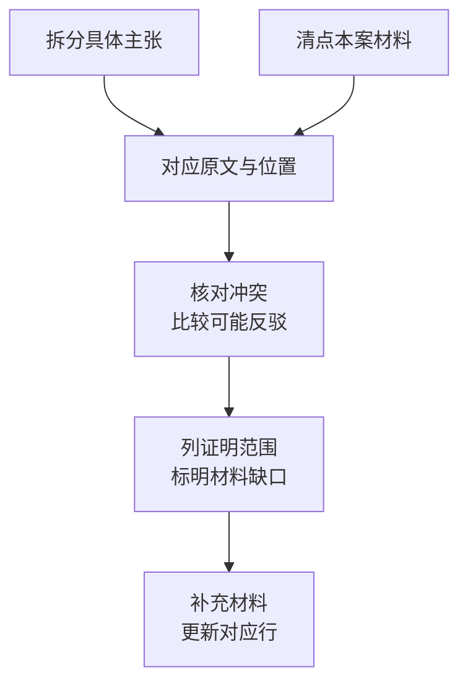

# 主张与证据对应

需要判断“哪些材料支持这项主张”“现有材料够不够”时，可以让执行事务形成主张与证据对应表。这是独立成果，不必成为每次咨询或文书生成的前置步骤。



## 从具体主张回到原材料

| 应列项目     | 用途                     |
| -------- | ---------------------- |
| 主张或法律要件  | 区分要求什么与需要证明什么          |
| 材料名称及位置  | 保留文件、页码或可核对片段          |
| 证明内容与范围  | 材料直接记载什么、哪些只是推论        |
| 三性及证明力意见 | 提供分析意见，不替代法院认证         |
| 冲突与补强方向  | 说明缺口会影响什么判断，避免泛泛“继续补证” |

一份盖章合同不必然证明全部履行，一张回单不必然证明付款用途，签字人不是法定代表人也不自动表示没有代理权限。需要结合内容、关系和反证分析。

## 操作示例：8份回单与仓储收入

甲公司提交8份回单，账面合计12万元；5份可与合同对应，另3份付款人与合同相对方不一致。完整园区收入、对应款项用途和账户余额未明确。

整理时保留“付款人不同”这一材料记载，不改写为收款人或关联关系；未提供代偿协议时，记为尚未提供，不推定协议或其他证据不存在。

```text
请把本次主张与8份回单、合同和说明逐项对应。
保留每份材料位置、收付款人、金额、用途及所支持的具体事实。
5份可对应合同与3份付款人不一致分别列出；后者保持性质待核，
不要把12万元账面合计写成已查明收入。
列出争议、可能反驳和影响结论的补强方向；没有材料支持的不要补造。
需要文件时，给我证据对应表Excel及简要研究说明Word的实际文件链接。
```

## 结果示例：材料与证明范围

| 主张             | 现有材料能做什么     | 仍需核对              |
| -------------- | ------------ | ----------------- |
| 回单共8份、账面合计12万元 | 按材料逐份核对数量与加总 | 清晰度、原件、重复及币种      |
| 5份与合同相关        | 列明逐笔对应关系与原文  | 用途、履行事项及对方异议      |
| 3份付款人不同        | 记录主体差异和附言    | 代付、其他交易或其他解释，不能预设 |
| 园区月收入为12万元     | 现有材料不足以自动支持  | 材料是否完整、款项性质和期间    |

证据标题、模型评分和材料排序不代替内容审查。没有检索到某材料只能说明本次范围，不能断言事件不存在。

## 操作示例：展开一项交付主张

以设备交付为例：合同要求交付后验收，现有签收单第一页记载“9月10日收到一批设备”，第二页照片模糊；9月12日的沟通记录又出现“设备还没到齐”。

第一轮可以这样提出：

```text
请核对“全部设备已按约交付并验收”这一主张。
分别摘录合同交付验收条款、签收单第一页和9月12日沟通的相关原文，保留位置。
签收单第二页标为已提供但未读清，不写成没有第二页。
比较分批交货、部分签收等可能解释，但没有材料支持时不替我选定一种。
列出会影响判断的具体补强方向，先给对应表，不起草诉状。
```

一行结果应能看出分析过程：主张是“全部交付并验收”；签收单目前只能帮助核对某次收货，仍须结合合同和上下文；沟通记录形成待解释的差异；需要补清晰页面、核对设备范围及签收人的身份和授权。不能只给“证据薄弱”四个字，也不能因为签收人不是法定代表人就直接否定签收。

拿到清晰第二页后，在原任务说明“请更新交付和验收行，并列出结论变化与来源”。人工验收时，抽查每个关键结论能否回到页面，检查未提供、未读清、未能证明三种状态是否分别记录。

## 补材料和改结论

同案新增材料时，说明它对应哪项主张或更正哪个数额，只更新受影响行及结论。需要[普通文书](/workflows/document-delivery/09-legal-documents)时继续提出目标，不必重新做整套表；涉及调查令则另核[地域与具体事项](/workflows/execution-audit/10-investigation-order)。
