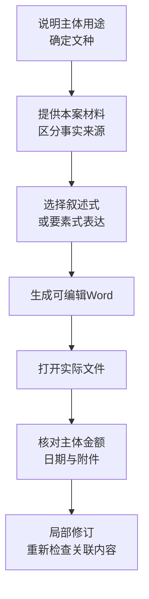

# 普通法律文书：从案情到可编辑Word

直接说明要取得什么文件，例如恢复执行申请书、答辩状、律师函、情况说明、法院裁定审查稿或要素式表格。普通法律文书由执行事务文书服务生成可编辑Word；[法律意见书](/workflows/document-delivery/11-legal-opinion-dual)和[调查令材料](/workflows/execution-audit/10-investigation-order)另有专用路径。



## 提供这五类信息

| 信息          | 例子                          |
| ----------- | --------------------------- |
| 制作主体和接收对象   | 申请执行人向执行法院提出申请，或法院拟制作审查稿    |
| 文种及目标       | 恢复执行申请书、叙述式说明、要素式调查表        |
| 本案事实及来源     | 材料直接记载、当事人陈述、争议与未知事项分别标明    |
| 主体、案号、金额和日期 | 按原材料保留名称、账号前导零；区分原案号与新案号    |
| 文件要求        | 可编辑Word、保存位置、拟稿日期、需要几份及如何命名 |

通常不必先选模板或自己整理固定字段表。服务先匹配适用母版，必要时按当前用途草拟；关键文种或分支有歧义时仍可能需要澄清。

## 操作示例：8份回单与12万元账面合计

本例材料为8份回单、账面合计12万元；5份可与合同对应，3份付款人与合同相对方不一致；完整园区收入和账户余额未知。叙述式文书适合交代资料经过，要素式表格适合按主体、账户和事项逐栏核对。两种体例都必须保留事实限定。

```text
请将这些仓储园区资料写成《收益资料交接情况说明》，交付可编辑Word及文件链接。
保留8份回单、账面合计120000元、5份可对应合同和3份付款人不一致等事实。
这只是提交材料的账面记录，不写成收入已经查实；完整收入和账户余额仍未知。
制作单位、接收对象及2026年10月10日拟稿日期按本次信息填写，
附件只列实际提供的目录。没有的人员和代理关系不补造。
```

改成要素式时，可以补充：“请保留完整陈述、核查对象、账户、核查期间和材料清单栏目，未知但适用的栏目留空。”表格结构不表示已经进行司法调查。

## 成品示例：叙述式情况说明

<figure className="ink-document-example" data-document-page="">
  <a href="/images/manual/narrative-statement.webp" target="_blank" rel="noopener noreferrer" aria-label="查看叙述式情况说明完整页">
    
  </a>
  <figcaption>叙述式情况说明成品示例：资料经过、金额限定、后续核对安排与落款。</figcaption>
</figure>

下面展示正文与落款的组织方式。正式制作时，将示例单位、接收对象和日期换成本件已确认的信息；附件按实际提供的材料列明。

```text
收益资料交接情况说明

本例接收机构：

我公司现就仓储园区收益相关资料的收集及交接情况，说明如下：

一、本次资料范围
本次提交合同资料和转账回单8份。经初步整理，其中5份回单可与相应合同
对应；另3份回单的付款人与合同相对方不一致，具体关系和付款性质尚待核实。

二、金额及未知事项
上述8份回单所涉金额账面合计为人民币120,000.00元。该数额仅为本次提交
回单的账面合计，尚需逐份核对原始凭证、重复情况及交易用途，不能据此认定
园区完整收入。园区当月完整收入及相关账户当前余额，本次仍未知。

三、后续核对安排
拟将合同、回单及后续取得的账册逐项对应，核对收付款人、日期、金额和
用途。对付款人不一致的3份回单另列待核清单，取得补充材料后更新说明。
尚未取得的材料不写为已经查明或已经提交。

附件：本次提供的转账回单目录（8份回单）

出具单位：示例甲有限公司
签章：________________
拟稿日期：2026年10月10日
```

这段示范的重点是让接收者读清资料从哪里来、目前能说明什么、哪些仍未知，以及下一步准备怎样核对。正式使用时，应将称谓、单位、日期和附件替换为本件已经确认的信息，不能直接沿用模拟落款。

## 同一材料改为要素式怎样写

需要逐栏核对账户、期间和材料时，可以采用下面的栏目。要素表仍应保留一段完整陈述，避免只剩孤立数字而丢失事实限定。

| 要素 | 本例填写示范 | 检查重点 |
| --- | --- | --- |
| 完整陈述 | 本次整理8份回单、账面合计12万元；5份可对应合同、3份付款人不同；完整收入与余额未知 | 与叙述式说明采用同一事实底稿 |
| 核查对象 | 乙公司及本例仓储园区 | 园区、经营主体和付款人分别记录，不自动合并身份 |
| 核查事项与期间 | 拟核对2026年9月的合同、回单与账册对应关系 | 这是拟核对范围，不表示已经完成调查 |
| 银行账户 | 【本案材料中的实际账号】 | 记录对应主体及材料来源，按文本保留前导零 |
| 开户行与余额 | 开户行：________；余额：________ | 未提供且适用时留空，不填“0”代替未知 |
| 关联案件 | 案号：________；程序阶段：按本案材料填写 | 没有新案号不编造“执恢”等编号 |
| 材料清单 | 本次实际提供的合同资料、8份回单及目录 | 拟提交与已提交状态分别写明 |
| 出具人与日期 | 按真实制作主体、授权关系和拟稿日期填写 | 不为排版对称添加第二名申请人或代理人 |

如只需要表格，可要求助手“把刚才同一事实改成要素式Word，不重复检索，不改变已确认数字；保留完整陈述和未知项”。生成后对照两种体例，检查12万元是否都仍限定为账面合计。

## 空项、附件与日期怎样处理

* 已知名称按材料写，不能擅自删掉名称中的“测试”“甲”“乙”。
* 适用但未知的信息保留标签和填写位置；自然人不添加法定代表人。
* 附件按本件用途与实际材料列明，无适用材料时不留空附件标题，也不把拟提交写成已经提交。
* 拟稿日期、实际签署日期与案件事件日期分开；不能用今天补造历史行为。
* 法院稿仅采用本案已确认事实，不把申请人的陈述写成“本院查明”。

## 获取成品与局部修改

生成成功应取得真实文件及可打开的链接。打开后检查主体、案号、金额、请求、附件、人员和日期；聊天中的正文或“已完成”不代替文件。生成失败时保留已完成的咨询，按错误提示处理，不把失败误报为模板不存在或已经取得成品。

```text
请只修改刚才申请书的申请事项第二项，采用我补充的【具体内容】；
拟稿日期改为2026年10月14日。其余已确认事实、附件及文种保持原意。
重新交付受影响文件的Word及文件链接，说明仍影响使用的关键缺项。
```

改请求时还应核对理由与金额是否需要同步。能生成Word不代表内容已获法院认可、已经签章、入卷、送达或采取措施。
