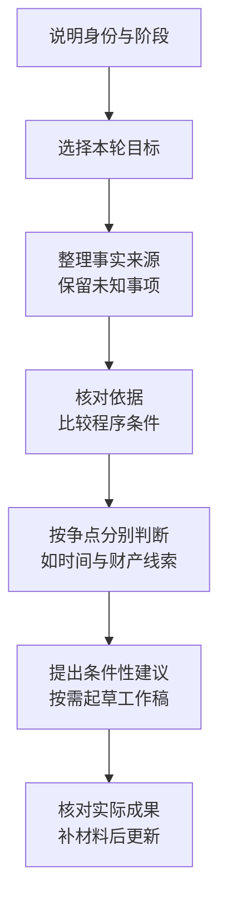

# 执行实施、争议审查与恢复执行

执行事务可以查找依据、分析执行问题、整理材料、计算案款和起草文书。先说明你是谁、案件处于什么阶段、本轮要解决什么问题；这些信息决定分析角度和产物。



## 先选本轮目标

| 目标          | 建议这样提出                   | 可取得的结果               |
| ----------- | ------------------------ | -------------------- |
| 当事人或代理人行动咨询 | 我该向哪个法院提出什么请求、准备哪些材料？    | 围绕当前问题的咨询答复与条件性建议    |
| 执行实施分析      | 从法院办理角度分析财产调查、处置、分配或终本条件 | 结论、法律分析、案例支撑、检索来源清单  |
| 执行争议审查      | 比较异议、复议、案外人救济或追加变更的程序    | 主体、争议对象、程序条件、证据及救济分析 |
| 实际文书        | 起草恢复执行申请书，提供可编辑 Word     | 生成后的文件及实际文件链接        |

行动咨询不必先做四段式报告、完整证据表和类案矩阵。只要文书时直接说明文种；同时咨询并要文书时，可以在同一任务中复用已经查得的依据。

## 操作示例：终本三年后取得账号线索

甲公司称，河南省某基层法院判决乙公司支付货款本金20万元及利息，2023年6月案件终本。2026年9月取得乙公司开户行、账号及近期小额转账回单，当前余额和资金性质未知。先核对执行依据、终本裁定、已付款和线索来源，再研究本轮问题。

恢复执行需要分开研究时间问题与财产条件。《最高人民法院关于严格规范终结本次执行程序的规定（试行）》第九条规定了终本后的恢复申请及法院核查要求，恢复申请不受申请执行时效期间限制；账号和回单本身不证明当前有可供执行资金。[查看最高人民法院原文](https://www.court.gov.cn/fabu/xiangqing/30111.html)

```text
我是申请执行人的代理人。请根据判决、终本裁定和转账回单分析：
1. 分开判断时间间隔、账户线索的调查价值与恢复条件；
2. 区分材料记载、当事人陈述、未知余额及仍需法院核查的事项；
3. 说明可以提出的请求、材料准备与风险，不保证恢复或回款；
4. 随后起草恢复执行申请书，交付可编辑Word及文件链接。
法院、原执行案号、已付款与线索来源按附件，不补造新案号或财产。
```

不要把终本、终结执行、执行和解违约混作同一个恢复理由。需要调查令时另说明地区、调查对象和事项，先查看[调查令范围与限制](/workflows/execution-audit/10-investigation-order)，不把调查令设为所有案件的必经步骤。

## 异议、复议和追加：把争议说具体

提出人可能是申请执行人、被执行人、利害关系人或案外人。争议可能针对某个执行行为，也可能涉及财产权属、主体追加或分配方案。不同争议不能仅凭“异议”二字选同一路径。

```text
我是【具体身份】，案件目前【阶段】。争议针对【具体行为、财产或主体】，
相关通知/裁定于【日期及送达方式】收到。请比较支持与反对理由，核对：
提出人资格、争议对象、前置程序、管辖、期限起算、证据与后续救济。
未知事实保持条件性，不把关联企业或股东关系直接认定为承担债务。
```

结果应说明所采用的规范、实务资料和案例各支持什么。案例缺少可靠原文时说明缺口，不凑案号；登记线索、模型推论与法院已经确认的事实分别表达。

## 收到结果后怎样继续

补充新材料时，指出它更正哪个事实、影响哪项判断或哪份文件。可以要求只修改受影响部分，不必重述整个案件。普通Word、[金额计算](/workflows/execution-audit/08-interest-calculation)与[法律意见书](/workflows/document-delivery/11-legal-opinion-dual)是不同产物，按本轮目标选择。

执行事务辅助研究和起草，不直接查询法院查控系统、银行余额或实施冻结扣划。法院角色与文书审查稿的使用见[法院办理与起草](/workflows/document-delivery/13-court-drafting)。
