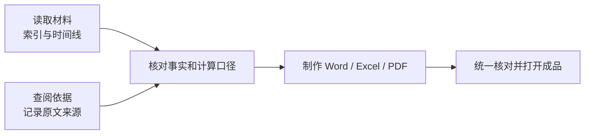

# 多步任务与并行协作

可以一次交代最终目标，让 Kayak 安排阅读、研究、核对和文书制作。小任务也可以只完成一个步骤；不必为了使用助手而把每次咨询扩展成整套报告。

## 安排一个完整任务

1. 明确材料目录或添加具体文件，说明保留原件和输出位置。
2. 列出需要的成果、计算口径和需要人工确认的判断。
3. 复杂任务先要求列出简明步骤，再按依赖顺序推进。
4. 完成后统一核对不同文件中的主体、案号、日期、金额和附件。



可以按下表验收阶段结果。它是一套完整任务的安排示例；只做其中一项时，不必额外制作所有文件。

| 阶段 | 可以要求的具体产物 | 继续前检查什么 |
| --- | --- | --- |
| 阅读整理 | 读取清单、材料索引和时间线 | 哪些已读、未读清或未提供，关键原文能否定位 |
| 法律研究 | 按争点整理的来源表及简要研究说明 | 原文支持什么命题，时间、地域和事实条件是否对应 |
| 核对计算 | 付款明细和保留公式的Excel | 重复交易、计息起止、抵充顺序和待定假设 |
| 起草文件 | 按本轮要求制作申请书、说明或意见书 | 文种、主体、请求、附件及实际文件链接 |
| 统一复核 | 各文件差异与仍待核事项清单 | 同一事实、金额和日期在各份成果中是否一致 |

```markdown
请处理我指定目录中的货款纠纷材料：
1. 保留原件，在工作副本中建立材料索引、时间线和证据对应表。
2. 围绕质量异议与剩余货款查阅公开依据，保留原文来源，不要求凑足案例数量。
3. 按实际交易去重付款，先说明计算起止日期和口径；依据不足的项目不要自行补利率。
4. 交付研究说明 Word、付款明细 Excel，以及我明确要求的申请文书。
5. 最后统一核对主体、日期和金额，列出仍有争议的事项，给出实际文件链接。
```

## 多任务与多代理怎么用

同一案件的不同研究可以放在一个任务中，由助手在可用时把互不依赖的工作交给子代理并行处理。例如一项整理时间线，另一项查公开规范，最后由主任务合并核对。你可以提出“把这些独立研究并行处理，最后统一核对”，但是否启用及并行数量取决于当前运行能力。

分别建立多个任务，适合不同案件或不同工作目标；同一目录的并行任务可能同时修改文件。开始前安排各自输出目录和文件名，避免多个任务覆盖同一份成果。

多代理不会把未经确认的事实变成已证实事实，也不保证没有等待。需要前一步结果的计算和起草，应等相关材料核对完成后再继续。

## 补材料与局部修订

在原任务中添加新材料，并明确它影响哪些成果：

> 新增《补充协议.pdf》，其中付款宽限期延长 30 天。请先核对原文，再更新付款时间线、相关计算和起诉状中的对应段落；其余已确认事实保持不变，另存新版本。

完成后检查关联结果是否都已更新。局部修改是可以提出的要求，不能保证每次自动发现全部下游影响；计算表、研究说明和文书主文中的关键数字仍需交叉核对。

## 中途出错或任务过长

使用停止按钮中断，说明要保留的结果、错误位置和下一步范围。目录里留下的文件可能已经保存，应先检查；不要假定停止会回滚整个任务。

任务过长时，要求先交付阶段性索引、已核对事实及未完成清单，再继续剩余部分。材料越多，越应保留文件位置和原文出处，避免只依赖对话摘要回忆案情。
