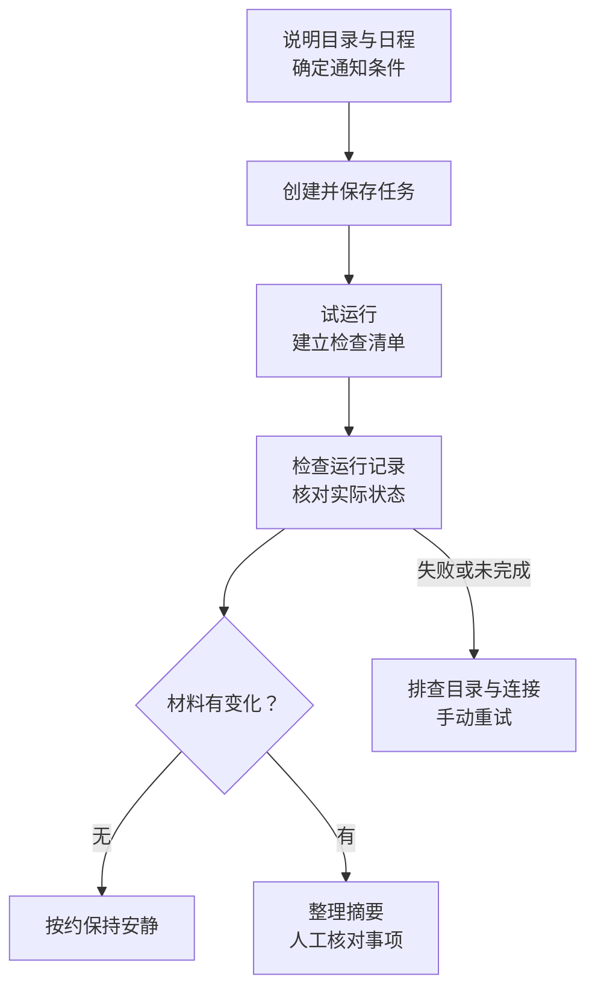

# 定时任务与案件动态跟进

Kayak 可以按计划执行重复任务，或在当前任务中继续跟进已约定的事项。例如检查指定案件目录的新文件、整理每日摘要，或提醒人工核对。它不会因为建立了提醒就自动核定法律期限。



## 创建并检查日程

1. 打开侧栏“定时任务”，使用创建入口；也可以在现有任务中直接要求助手建立定时跟进。
2. 说明具体工作、材料目录、日期和时间、重复频率，以及使用的时区。说明无变化时是否保持安静、出现什么情况才通知。
3. 创建后打开任务详情，检查日程、状态、运行位置、项目或目录和通知设置。只看到建议或聊天文字时，先确认任务是否已经保存。
4. 先要求立即试运行一次，核对是否读取了正确目录、是否生成了预期摘要，再观察下一次计划时间。

```markdown
请建立定时跟进：每个工作日上午 9:00，使用北京时间。
只检查我指定的“货款案/01_原始材料”目录，比较自上次成功检查以来新增或修改的文件。
首次运行先建立文件清单，不把所有旧材料都当新材料。
发现变化时列出文件名、变化内容和待人工核对事项；无变化时不通知。
保留原件，摘要另存本案工作目录，不向第三方发送或共享任何内容。
请创建后给出计划、运行位置和下次运行时间，并先试运行一次。
```

用“自上次成功检查以来”比固定“过去 24 小时”更适合经历周末或运行中断的任务。是否有可靠的上次清单仍需在试运行中核对；没有基线时应先建立清单。

## 运行条件与结果检查

读取本地目录的任务依赖本机可用。安排运行时保持电脑和 Kayak 可运行、账号有效，并确保任务所需的网络、目录及外部授权可用。不要假定关闭客户端、关机或休眠后仍会按时读取本地文件，也不要假定恢复后必定补跑。

计划时间到了没有结果时，打开“定时任务”的运行历史，检查是否已触发、失败或仍在运行；再检查客户端、目录路径、网络与相关插件授权。先手动试运行确认原因，避免反复建立重复任务。

定时执行使用系统配置的运行模型，不能仅凭当前聊天中的模型选择推定其使用同一模型。需要特定处理方式时，把要求写入任务内容并检查实际输出。

## 暂停、修改与删除

在定时任务列表或详情中使用“暂停”；恢复时使用“继续”，并核对下次运行时间。要调整目录、频率或输出位置，可编辑任务详情，或明确告诉助手修改哪项日程。

删除会停止未来计划；它不会自动删除已经生成的文件，也不能撤回已执行的外部动作。只想暂时停用时，优先使用暂停。

## 案件期限仍需人工管理

诉讼时效、上诉期限、执行申请及异议等期限，适用规则、起算点和顺延条件可能不同，不能混称同一类期限。让助手协助列日历时，提供文书、送达方式和确认日期，并核对其依据。

所有关键期限都应按本单位流程登记、复核和督办。定时任务可作辅助提醒；法院工作人员仍应使用院内认可的期限管理与审批流程。

## 日常纪要也可单独处理

接待记录或会议文字不必先建立定时任务。直接要求“按记录整理人员、各方陈述、已确认安排、责任人与待办，提供 Word；未出现的承诺不要补写”。录音或手写材料先确认可用的转写、识别方式及数据授权，识别结果再与原记录核对。
